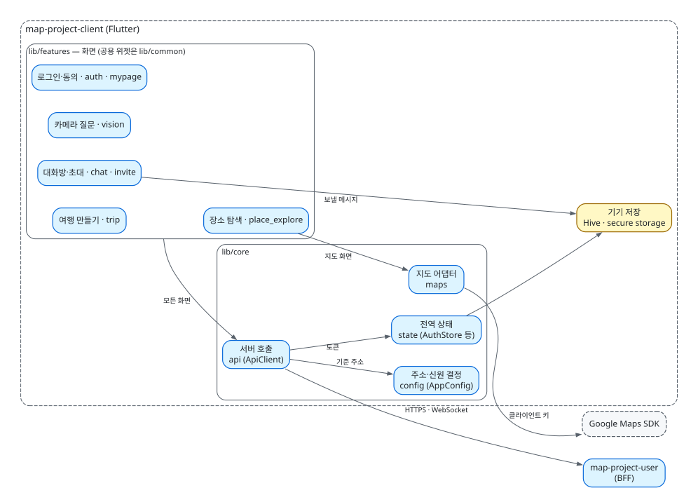
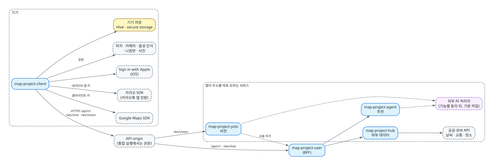
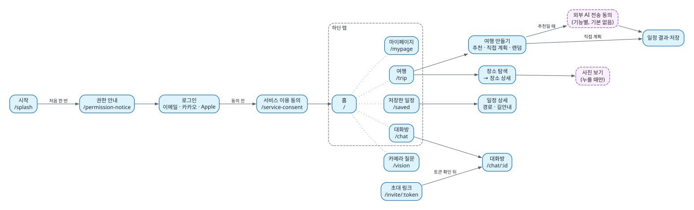

# map-project-client

MAP 의 모바일 앱이다. 여행 지역·날짜·취향을 고르면 서버가 만든 일정을 지도 위 동선으로 보여 주고, 함께 가는 사람과 대화방에서 일정을 나눈다. Flutter 하나로 iOS·Android(그리고 웹)를 만든다.

## 저장소 지도

MAP 는 일곱 저장소로 이루어져 있다. 전체 구조와 한 번에 실행하는 방법은 [map-project-infra](https://github.com/we-meet-trip/map-project-infra) 에서 시작한다.

| 저장소 | 역할 |
|---|---|
| [map-project-infra](https://github.com/we-meet-trip/map-project-infra) | 전체 안내, 로컬 실행 구성(Docker Compose), DB 초기화 |
| **[map-project-client](https://github.com/we-meet-trip/map-project-client)** | **모바일 앱(Flutter, iOS·Android)** |
| [map-project-user](https://github.com/we-meet-trip/map-project-user) | 사용자 BFF(Spring Boot): 인증·일정·채팅·동의, 다른 서비스 중계 |
| [map-project-agent](https://github.com/we-meet-trip/map-project-agent) | 추천 에이전트(FastAPI·LangGraph): 장소·경로·일정 생성 |
| [map-project-hub](https://github.com/we-meet-trip/map-project-hub) | 외부 데이터 게이트웨이(FastAPI·PostGIS): 관광·날씨·장소·경로 |
| [map-project-yolo](https://github.com/we-meet-trip/map-project-yolo) | 비전 서비스(WebSocket, 객체 탐지 + LLM 식별) |
| [map-project-admin](https://github.com/we-meet-trip/map-project-admin) | 운영 콘솔(FastAPI·React) |

## 이름의 뜻

- `map-project` 는 MAP 프로젝트의 공개 저장소 묶음 이름이다. 일곱 저장소가 같은 접두를 쓴다.
- `client` 는 사람이 직접 쓰는 앱이라는 뜻이다. 서버 쪽 서비스는 모두 사용자 BFF([map-project-user](https://github.com/we-meet-trip/map-project-user)) 뒤에 있고, 앱은 그 BFF 하나만 부른다.

## 개요

- 앱은 화면과 기기 기능(지도·위치·카메라·음성 인식)을 맡고, 추천·외부 데이터·비전 판단은 서버가 맡는다.
- 앱에는 서버용 키가 없다. 들어가는 것은 기기에 묶어 제한할 수 있는 클라이언트 키(지도 SDK, 카카오 네이티브 앱 키)뿐이고, 그것도 빌드할 때 직접 넣는다.
- 공개본의 기본값은 어떤 운영 서버도 가리키지 않는다. 값을 주지 않은 개발 빌드는 로컬 서버(`http://localhost:8080`)를 본다.
- 외부 AI 처리자로 입력이 가는 기능(추천·재탐색·리뷰 요약·Vision)은 기능마다 따로 묻는 동의가 있어야 쓰고, 기본은 동의 없음이다.

## 아키텍처

<picture>
  <source media="(prefers-color-scheme: dark)" srcset="docs/diagrams/app-structure-dark.svg">
  
</picture>

<picture>
  <source media="(prefers-color-scheme: dark)" srcset="docs/diagrams/sdk-boundary-dark.svg">
  
</picture>

계층·처리 순서·타임아웃은 [docs/architecture.md](docs/architecture.md), 그림의 근거는 [docs/diagrams/CLAIMS.md](docs/diagrams/CLAIMS.md) 에 있다.

## 기능

<picture>
  <source media="(prefers-color-scheme: dark)" srcset="docs/diagrams/screen-flow-dark.svg">
  
</picture>

- **여행 만들기**: 추천(지역·날짜·이동수단·취향을 고르면 서버가 일정 생성), 직접 계획, 랜덤 미션 세 갈래. 지역 선택 지도에 시도·시군구 윤곽을 그린다.
- **장소 탐색**: 장소 상세에서 블로그 후기와 요약을 보고, 사진은 '사진 보기'를 누를 때만 불러온다.
- **일정과 길안내**: 저장한 일정의 동선, 대중교통·도보 경로, 날씨 특보 배너, 공유 자전거·킥보드 위치.
- **대화방**: 일정을 함께 보는 실시간 채팅(STOMP), 초대 링크, 보내지 못한 메시지 다시 보내기.
- **카메라 질문(Vision)**: 사진과 질문(음성 입력 가능)을 보내 답을 받는다.
- **계정과 동의**: 이메일·카카오·Apple(iOS) 로그인, 서비스 이용 동의, 외부 AI 전송 동의 설정, 신고·차단.

## 빠른 시작

외부 키와 비용 없이 시험과 개발 빌드를 돌린다.

필요한 것: Flutter 3.41.9(stable), Python 3(시험과 iOS 빌드 가드), Android SDK 또는 Xcode.

```sh
git clone https://github.com/we-meet-trip/map-project-client.git
cd map-project-client
sh scripts/fetch_fonts.sh      # 앱 글꼴을 받는다(네트워크 필요, 처음 한 번)
flutter pub get
flutter test
```

앱을 띄워 로그인부터 써 보려면 서버가 있어야 한다. [map-project-infra](https://github.com/we-meet-trip/map-project-infra) 의 빠른 시작으로 서버를 띄운 뒤 그 주소를 넘긴다.

```sh
# Android 에뮬레이터(호스트 PC 는 10.0.2.2)
flutter run --dart-define=CLIENT_API_BASE_URL=http://10.0.2.2:8080
# iOS 시뮬레이터
flutter run --dart-define=CLIENT_API_BASE_URL=http://localhost:8080
```

- 지도 키를 넣지 않으면 지도 화면은 지도 없이 뜨고 나머지 화면은 그대로 돈다.
- 카카오 키를 넣지 않으면 카카오 로그인 버튼만 동작하지 않는다. 이메일 로그인은 서버만 있으면 된다.
- 평문(http) 서버 주소는 debug 빌드에서만 받는다.

## 설정

모든 설정은 빌드값(dart-define)이고 이름은 `CLIENT_` 로 시작한다. 목록과 설명은 [`.env.example`](.env.example) 에 있다. 복사해 채운 뒤 `--dart-define-from-file` 로 넘긴다.

```sh
cp .env.example .env
flutter run --dart-define-from-file=.env
```

| 빌드값 | 비었을 때 |
|---|---|
| `CLIENT_APP_ENV` | `test`(번들 ID `map.project.client.dev`). 운영 빌드는 `prod` |
| `CLIENT_API_BASE_URL`·`CLIENT_APP_CONFIG_URL` | 로컬 서버를 본다 |
| `CLIENT_API_ALLOWED_ORIGINS` | 릴리스 빌드는 어떤 서버도 믿지 않는다(`prod` 는 필수) |
| `CLIENT_INVITE_LINK_ORIGIN` | https 초대 링크 대신 앱 전용 스킴(`mapproject-dev://invite/…`)만 쓴다 |
| `CLIENT_PUBLIC_SITE_ORIGIN`·`CLIENT_SUPPORT_EMAIL` | 약관 메뉴와 문의하기를 감춘다 |
| `CLIENT_GOOGLE_MAPS_*_API_KEY`·`CLIENT_KAKAO_NATIVE_APP_KEY` | 지도·카카오 로그인을 쓰지 않는다 |

iOS 를 다른 환경으로 빌드할 때는 빌드 가드로 xcconfig 를 만든다.

```sh
python3 ios/Flutter/verify_native_environment.py --print-xcconfig \
  CLIENT_APP_ENV=prod CLIENT_INVITE_LINK_ORIGIN=https://example.com > ios/Flutter/NativeEnvironment.xcconfig
```

스토어에 올리려면 자기 번들 ID·서명·키를 직접 준비한다. 이 저장소의 번들 ID(`map.project.client`)는 소유한 도메인을 뜻하지 않는다.

## 데이터

저장소에 담은 자료는 OpenStreetMap 에서 만든 행정경계 윤곽(ODbL)과 팀이 만든 그림 자산뿐이다. 글꼴은 빌드 때 받는다. 출처·이용조건·만드는 법·한계는 [docs/data.md](docs/data.md) 에 있다.

## API와 계약

앱이 부르는 경로, 인증·오류 형식, 정책 판·초대 링크·원격 설정 문서의 약속은 [docs/contracts.md](docs/contracts.md) 에 있다. 경로의 정의는 [map-project-user](https://github.com/we-meet-trip/map-project-user) 가 기준이다.

## 폴더 구조

```
lib/
  main.dart, app.dart     진입점·라우터 연결
  features/<기능>/        화면(trip · place_explore · saved · chat · invite · vision · auth · mypage · moderation · …)
  common/                 공용 위젯·테마·상수(지역 목록 등)
  core/api/               서버 호출(ApiClient 와 기능별 서비스)
  core/config/            서버 주소·허용 origin·앱 신원
  core/maps/              지도 SDK 어댑터(네이티브·웹)
  core/state/             로그인·동의 상태
  data/                   기기 저장·저장소
assets/                   그림·아이콘·행정경계(geo, ODbL)
android/ ios/ web/        플랫폼 설정(ios/Flutter/verify_native_environment.py 는 빌드 가드)
scripts/                  글꼴 받기·행정경계 만들기·다이어그램 그리기, 빌드 가드 시험(tests/)
docs/                     구조·데이터·계약·트러블슈팅·결정 기록·다이어그램
test/ integration_test/   시험
```

## 테스트

```sh
sh scripts/fetch_fonts.sh
flutter pub get
python3 -m unittest discover -s scripts/tests -v                                   # 빌드 가드 7개
flutter test                                                                        # 539 통과, 2 건너뜀
flutter test test/core/app_environment_prod_test.dart --dart-define=CLIENT_APP_ENV=prod   # 2 통과
flutter analyze
```

- 건너뛰는 2개는 운영 빌드에서만 의미 있는 시험이고, 마지막에서 두 번째 명령으로 따로 돌린다.
- `integration_test/` 는 실제 서버와 기기가 필요해 CI 에서 돌리지 않는다.
- CI(`.github/workflows/ci.yml`)도 같은 순서로 돌고, 비밀값을 쓰지 않는다.

## 트러블슈팅과 교훈

개발하면서 겪은 문제와 고친 방법은 [docs/troubleshooting.md](docs/troubleshooting.md) 에 있다. 몇 가지는 다음과 같다.

- 웹 빌드에서 지도가 회색 상자로만 보였다(T-MAP-01). 플러그인의 지원 플랫폼을 먼저 확인한다.
- 초대 링크가 앱 대신 브라우저로 열렸다(T-LINK-01). 도메인·패키지·서명 지문 중 하나만 어긋나도 오류 없이 실패한다.
- 서버가 정책 판을 올리면 설치된 앱이 잠길 수 있었다(T-CONSENT-02). 서버가 바꾸는 값을 앱에 상수로 굽지 않는다.

설계 결정은 [docs/decisions/](docs/decisions/) 에 MADR 형식으로 있다.

## 한계

- 교육·학습용 공개본이다. 스토어 배포·서명·호스팅 게시 도구는 들어 있지 않다.
- 로그인부터 대부분의 기능이 서버(map-project-user 와 그 뒤 서비스)를 필요로 한다.
- 지역 목록은 서버 표기(개칭 전 시도 이름, 개편 전 시군구)를 쓴다. 인천광역시 중구·동구는 지도 윤곽 없이 목록으로만 고른다.
- 앱 글꼴을 받는 단계는 네트워크가 필요하다.
- iOS 빌드와 기기 동작은 이 공개본에서 CI 로 확인하지 않는다(CI 는 Linux 에서 시험·분석만 한다).

## 감사 표시

- 행정경계: © OpenStreetMap contributors, [ODbL 1.0](https://opendatacommons.org/licenses/odbl/1-0/) — 해안선 육지 다각형은 osmdata.openstreetmap.de 에서 받았다.
- 글꼴: [Pretendard](https://github.com/orioncactus/pretendard), Copyright (c) Kil Hyung-jin, [SIL Open Font License 1.1](https://openfontlicense.org).
- 아이콘: [Phosphor Icons](https://phosphoricons.com)(`phosphor_flutter`, MIT), Material Icons(Flutter).
- 그림 자산: 팀 제작.

## 고지

- 이 저장소는 교육·학습 목적으로 공개한 코드다. 운영 중인 서비스가 아니며 지원을 약속하지 않는다.
- 이 프로젝트는 코드가 연동하는 외부 서비스·데이터 제공자(한국관광공사, 기상청, 공공데이터포털, 국토교통부, 서울특별시, 한국환경공단, 카카오, 네이버, Google, Apple, LangChain, ODsay, OpenStreetMap, Ultralytics, Wikimedia 등)와 관련이 없으며, 그들로부터 승인이나 후원을 받지 않았다. 언급한 상표와 서비스 이름은 각 소유자에게 있다.
- 저장소에는 제3자 데이터·이미지·본문을 넣지 않는다. 예외로, 이용조건을 원문으로 확인한 공공·개방 자료만 출처와 이용조건을 밝혀 담는다(`docs/data.md`). 그 밖의 외부 데이터는 각 제공자의 약관에 따라 직접 받아야 한다.
- MIT 라이선스는 이 저장소의 코드에만 적용된다. 저장소에 담은 공공·개방 자료와 외부 데이터, 모델 가중치, 폰트, 라이브러리는 각자의 이용조건·라이선스를 따른다.

## 라이선스

코드는 [MIT 라이선스](LICENSE)를 따른다. Copyright (c) The MAP Contributors. 만든 사람들은 [AUTHORS.md](AUTHORS.md) 에 있다.
