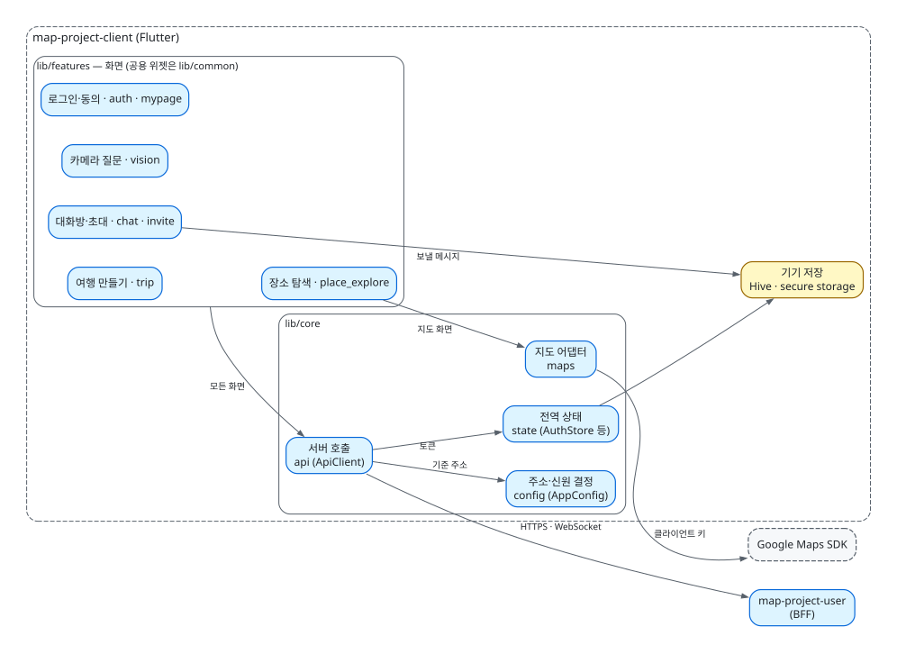

# 구조

map-project-client 는 MAP 의 모바일 앱이다. Flutter 하나로 iOS·Android(그리고 웹 빌드)를 만든다. 앱은 서버 주소(API origin) 하나만 부른다. 그 주소의 REST(`/api/v1`)와 채팅(`/ws/chat`)은 사용자 BFF(map-project-user)가, 카메라 질문(`/ws/vision`)은 비전 서비스(map-project-yolo)가 받는다. 통합 실행에서는 관문이 경로별로 나눠 보낸다. 추천·외부 데이터는 BFF 뒤의 서비스가 맡고, 앱에는 서버용 키가 없다.

## 계층

| 폴더 | 역할 | 예 |
|---|---|---|
| `lib/features/<기능>/` | 화면과 그 화면만 쓰는 위젯·모델 | `trip`(여행 계획 단계), `chat`(대화방), `vision`(카메라 질문), `place_explore`(장소 탐색), `saved`·`mypage`·`auth`·`invite`·`moderation` |
| `lib/common/` | 여러 화면이 같이 쓰는 위젯·테마·상수 | `common/widgets/external_ai_consent.dart`(외부 AI 전송 동의), `common/constants/korea_regions.dart`(지역 목록) |
| `lib/core/api/` | 서버 호출. 기능별 서비스가 공통 통로 `ApiClient` 를 거친다 | `api_client.dart`, `trip_api_service.dart`, `chat_realtime_service.dart` |
| `lib/core/config/` | 서버 주소·앱 신원·허용 origin 결정 | `app_config.dart`, `app_environment.dart`, `endpoint_policy.dart` |
| `lib/core/maps/` | 지도 SDK 어댑터. 네이티브와 웹을 조건부 import 로 가른다 | `map_bootstrap.dart`, `map_adapter.dart`, `map_loader_web.dart` |
| `lib/core/state/` | 로그인·동의·일정 같은 앱 전역 상태(Provider) | `auth_store.dart`, `service_consent_store.dart` |
| `lib/data/` | 기기 저장(Hive·secure storage)과 저장소 인터페이스 | `local/chat_outbox_store.dart`, `repositories/api_invite_link_repository.dart` |

진입점은 `lib/main.dart` → `lib/app.dart` 이고, 화면 이동은 `go_router`(`lib/core/router/app_router.dart`)가 맡는다.

## 처리 순서

1. **시작**(`lib/main.dart`): 기기 저장소(Hive)를 열고, `AppConfig.init()` 으로 서버 주소를 정한 뒤(아래), 카카오 키가 있으면 카카오 SDK 를 켜고, 저장해 둔 로그인 토큰을 되살린다. 지도 SDK 는 서비스 이용 동의를 확인한 뒤에 불러온다(`service_consent_screen.dart` 의 `initializeMaps`).
2. **로그인**: 이메일, 카카오 SDK, Apple 로그인 중 하나로 인증하고, BFF 가 준 토큰을 secure storage 에 둔다. 서비스 이용 동의(약관·개인정보·연령)는 서버 기록을 기준으로 한다.
3. **여행 만들기**: 지역·날짜·이동수단·취향을 단계별로 고른 뒤 `/api/v1/trip/generate` 를 부른다. 추천은 오래 걸릴 수 있어 이 호출만 상한이 길다.
4. **외부 AI 전송**: 추천·재탐색·리뷰 요약·Vision 처럼 입력이 외부 AI 처리자로 가는 기능은 기능마다 따로 묻는 동의가 있어야 요청한다(`ensureExternalAiConsent`). 기본은 동의 없음이다.
5. **대화방**: STOMP over WebSocket(`/ws/chat`)으로 실시간 메시지를 받는다. 서버가 받았다고 확인하기 전의 메시지는 환경·계정·방별로 암호화해 기기에 두었다가 다시 보낸다(`chat_outbox_store.dart`).
6. **Vision**: 카메라 사진과 질문(음성 인식 포함)을 같은 API origin 의 WebSocket(`/ws/vision`)으로 보내고 답을 받는다. 이 연결은 비전 서비스가 받고, 비전 서비스는 앱이 보낸 로그인 토큰으로 user 에 하루 사용 허가를 받는다.

## 서버 주소 정하기

`lib/core/config/app_config.dart` 가 정하는 순서는 다음과 같다.

1. `CLIENT_API_BASE_URL` 빌드값. 주면 원격 조회를 하지 않는다. 개발용이다.
2. `CLIENT_APP_CONFIG_URL` 로 위치를 준 원격 설정 문서(JSON)의 `api_base_url`.
3. 마지막으로 성공했던 값(기기 캐시).
4. 로컬 기본값 `http://localhost:8080`.

릴리스 빌드는 `CLIENT_API_ALLOWED_ORIGINS` 에 있는 https origin 만 믿는다. 운영 빌드(`CLIENT_APP_ENV=prod`)는 이 목록을 반드시 직접 줘야 하고, 어긋나면 어떤 서버도 부르지 않는다(`endpoint_policy.dart`). 공개본 기본값에는 서버 주소가 하나도 없다.

## 빌드값이 없을 때

| 빌드값 | 비었을 때 |
|---|---|
| `CLIENT_API_BASE_URL`·`CLIENT_APP_CONFIG_URL` | 로컬 서버를 본다 |
| `CLIENT_INVITE_LINK_ORIGIN` | https 초대 링크를 받지 않고, 앱 전용 스킴(`mapproject-dev://invite/<토큰>`)만 쓴다. 앱 링크 도메인 자리는 예약 도메인 `invite.example.invalid` 로 채운다 |
| `CLIENT_PUBLIC_SITE_ORIGIN` | 약관·정책 메뉴와 원문 링크를 감춘다 |
| `CLIENT_SUPPORT_EMAIL` | 고객센터·문의하기를 감춘다 |
| `CLIENT_GOOGLE_MAPS_*_API_KEY` | 지도 화면은 지도 없이 뜬다(`mapsReady` 가 거짓) |
| `CLIENT_KAKAO_NATIVE_APP_KEY` | 카카오 로그인 버튼만 동작하지 않는다. Android 운영 빌드는 빌드 단계에서 막는다 |

## 네이티브 설정과 빌드 가드

번들 ID·초대 스킴·카카오 복귀 스킴·앱 링크 도메인은 Dart 빌드값과 네이티브 설정 두 곳에 있다.
- Android: `android/app/build.gradle.kts` 가 dart-define 을 읽어 applicationId·매니페스트 자리를 채운다.
- iOS: `ios/Flutter/EnvironmentDefaults.xcconfig`(로컬 기본값)와 선택 파일 `NativeEnvironment.xcconfig` 가 빌드 설정을 정한다. 매 Xcode 빌드에서 `ios/Flutter/verify_native_environment.py` 가 두 값을 대조하고, 어긋나면 빌드를 멈춘다(`project.pbxproj` 의 Run Script). 다른 환경용 xcconfig 는 같은 스크립트의 `--print-xcconfig` 로 만든다.

| 환경 | 번들 ID | 초대 스킴 | 표시 이름 |
|---|---|---|---|
| `test`(기본) | `map.project.client.dev` | `mapproject-dev` | MAP Dev |
| `prod` | `map.project.client` | `mapproject` | MAP |

## 외부 의존성

| 대상 | 쓰는 곳 | 비고 |
|---|---|---|
| map-project-user(BFF) | REST(`/api/v1`)·채팅(`/ws/chat`) | 경로는 [contracts.md](contracts.md) |
| map-project-yolo(비전 서비스) | 카메라 질문(`/ws/vision`) | 같은 API origin 으로 접속한다(관문이 나눠 보냄) |
| Google Maps SDK(`google_maps_flutter`) | 지도 화면 | 플랫폼별 클라이언트 키. 키가 없으면 지도 없이 동작 |
| 카카오 SDK(`kakao_flutter_sdk_user`) | 카카오 로그인 | 네이티브 앱 키 |
| Sign in with Apple(`sign_in_with_apple`) | Apple 로그인 | iOS |
| 기기 기능 | 위치(`geolocator`), 나침반, 카메라, 음성 인식, 사진 선택 | 선택 권한을 왜 쓰는지 처음 한 번 알리는 화면이 있다(`features/notice`) |

## 타임아웃과 한도

| 대상 | 값 | 근거 |
|---|---|---|
| 원격 설정 조회 | 3초. 실패하면 3초·10초·30초·2분·5분 뒤 다시 시도 | `lib/core/config/app_config.dart` |
| 일반 API | 30초 | `lib/core/api/api_client.dart` |
| 여행 생성·재추천 | 180초 | `lib/core/api/trip_api_service.dart` |
| 장소 사진·후기·자전거·킥보드·지하철 조회 | 15초 | 각 `*_api_service.dart` |
| 대중교통 경로 선택지 | 8초 | `lib/core/api/transit_route_options_service.dart` |
| 실시간 채팅 연결 | 10초 | `lib/core/api/chat_realtime_service.dart` |
| 초대 토큰 | `[A-Za-z0-9_-]{1,256}` | `lib/core/services/deep_link_service.dart` |
| 정책 판 문자열 | `^[A-Za-z0-9][A-Za-z0-9._-]{0,31}$` | `lib/core/state/service_consent_store.dart` |
